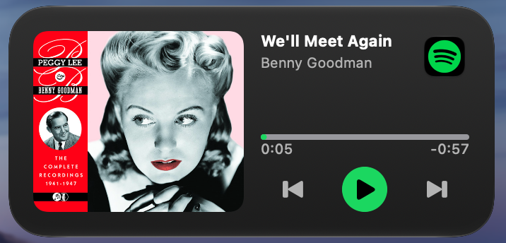

# Spotify Notification Center Widget

A macOS widget for Notification Center that shows what Spotify is playing and lets you control it.



- Album cover, track name, artist (album name in the large size)
- Live progress bar with elapsed / remaining time
- Previous, play/pause, next
- Tap the cover to open the track's album page in Spotify
- Tap the Spotify icon to bring Spotify to the front (or launch it)
- Small, medium and large sizes

## How it works

Widgets can't talk to Spotify directly, so a small background app (no Dock or menu bar icon, starts at login) does it:

1. It listens to Spotify's playback notifications and reads the current track via AppleScript.
2. It stores the track info and cover art in a shared App Group container and asks the widget to reload.
3. Widget buttons post a notification the background app turns into a Spotify AppleScript command.

## Requirements

- macOS 14+
- Xcode (selected with `sudo xcode-select -s /Applications/Xcode.app`)
- An Apple ID added in Xcode → Settings → Accounts (a free personal team works)
- [XcodeGen](https://github.com/yonaskolb/XcodeGen): `brew install xcodegen`

## Build and install

```sh
make install TEAM_ID=<your team ID>
```

This generates the Xcode project, builds a signed Release app and copies it to `~/Applications/SpotifyWidget.app`.
Your team ID is the `OU` field of your Apple Development certificate:

```sh
security find-certificate -c "Apple Development" -p | openssl x509 -noout -subject
```

Then:

1. Open `~/Applications/SpotifyWidget.app` once and allow it to control Spotify.
2. Open Notification Center → Edit Widgets → search "Spotify" → add a size.

After reinstalling, restart the processes so the new version loads:

```sh
killall SpotifyWidget SpotifyWidgetExtension NotificationCenter; open ~/Applications/SpotifyWidget.app
```

## Other commands

| Command | What it does |
|---|---|
| `make test` | Run unit tests for the shared `NowPlayingKit` package |
| `make check` | Compile without signing |
| `make gen` | Generate `SpotifyWidget.xcodeproj` only |

To stop it, run `killall SpotifyWidget` and remove it from System Settings → General → Login Items.
